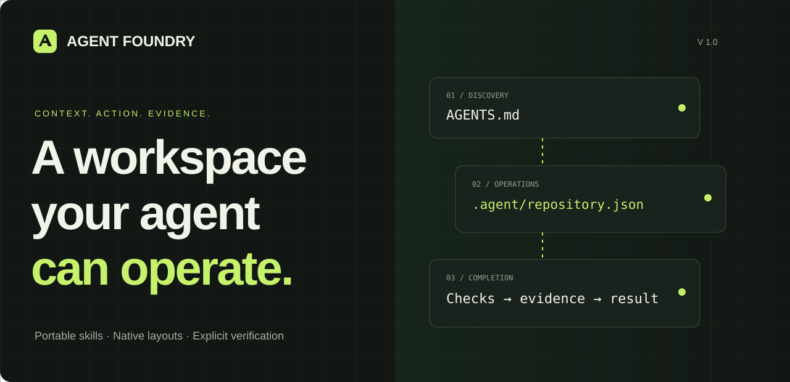
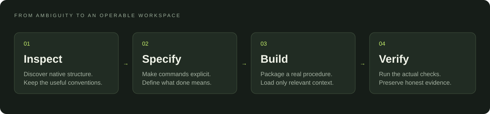

<p align="center"></p>

<p align="center">
  <a href="https://aleksanderamid.github.io/agent-foundry/"><strong>Explore the website ↗</strong></a> ·
  <a href="#install">Install</a> ·
  <a href="#what-it-does">Capabilities</a> ·
  <a href="skills/agent-foundry/references/research.md">Research</a>
</p>

<p align="center">
  
  
  
</p>

**Agent Foundry turns research about agent-ready repositories and reusable skills
into a small, working toolkit.** Keep your native project structure. Give the agent
explicit operational facts, focused procedures, and verifiable completion checks.

It combines a portable `SKILL.md`, a Codex interface adapter, five focused
references, and a dependency-free Python CLI. It does not promise a universal
optimal layout or guaranteed gains in AI performance.

## What it does

| Capability | Result |
| --- | --- |
| Inspect a workspace | Bounded inventory of native manifests and existing interface validity |
| Initialize an agent interface | `AGENTS.md`, a strict `.agent/repository.json`, and its schema |
| Validate a repository | Schema, path, command-ID, and structural readiness checks |
| Resolve a command | Explicit arguments and working directory, without executing it |
| Package a skill | A complete instruction-only package from a procedure you supply |
| Validate a Foundry skill | Metadata profile, direct references, Python syntax, and file digests |
| Install a fresh copy | Staged, verified installation with no overwrite of an existing skill |



## Install

Requires **Python 3.11+** and Git. No package installation or API key is needed.
Clone and inspect the source, then install:

```sh
git clone https://github.com/AleksanderAmid/agent-foundry.git
cd agent-foundry
python skills/agent-foundry/scripts/foundry.py install --host codex --apply
```

Codex uses `$CODEX_HOME/skills/agent-foundry`, falling back to
`~/.codex/skills/agent-foundry`. On your next turn, try:

```text
Use $agent-foundry to inspect this repository and implement the smallest useful
agent interface. Preserve its existing layout and verify the actual commands.
```

For Claude Code, use `--host claude` and invoke `/agent-foundry`. For a host that
discovers the shared `~/.agents/skills` root, use `--host agents`. These are
installation targets, not claims that every host has been behaviorally tested.
Read the [installation notes](skills/agent-foundry/references/installation.md)
for discovery differences, custom locations, and updates. Avoid duplicate copies.

Omit `--apply` to preview the installation. An existing destination is preserved
and reported as a conflict; the installer never silently upgrades or deletes it.

## Try the tools

Run these from the cloned repository, replacing `../your-project` with the target:

```sh
python skills/agent-foundry/scripts/foundry.py inspect --root ../your-project
python skills/agent-foundry/scripts/foundry.py init --root ../your-project --name your-project
```

The second command is a dry run. Add `--apply` when ready to create the interface.
It leaves existing source files in place and refuses conflicting output paths.
Populate the manifest with your project's real commands, then validate:

```sh
python skills/agent-foundry/scripts/foundry.py validate --root ../your-project
python skills/agent-foundry/scripts/foundry.py command --root ../your-project --id test
```

The `command` operation **does not execute** the command. Review it and run it
through your agent's authorized environment. Empty command lists are deliberately
reported as incomplete setup. A structural pass is not a passed application test.

For skill authoring, supply an actual procedure in a UTF-8 file:

```sh
python skills/agent-foundry/scripts/foundry.py scaffold-skill --destination ./my-skills --name contract-review --description "Compare public API snapshots for client-breaking changes." --procedure-file procedure.txt --apply
python skills/agent-foundry/scripts/foundry.py validate-skill --path ./my-skills/contract-review
```

All tool operations return JSON. Successful operations exit `0`; validation,
input, and conflict failures exit `2`. CLI usage errors follow argparse's normal
error output. Use `--help` for the complete interface.

## Small package. Explicit boundaries.

```text
skills/agent-foundry/
├── SKILL.md                 task selection and working sequence
├── agents/openai.yaml       Codex presentation and invocation metadata
├── scripts/foundry.py       deterministic tools; standard library only
├── references/              load only the relevant workflow
└── assets/                  strict schemas and the skill icon
```

The portable metadata uses a JSON object inside YAML frontmatter. This is a
YAML-compatible, intentionally strict authoring profile. The bundled validator
checks **Foundry's profile**, not every possible YAML skill or JSON Schema
keyword. The `.agent/` contract is a project convention, not a native host API.

## Verification and evidence

```sh
python -B -m unittest discover -s tests -v
python -B skills/agent-foundry/scripts/foundry.py validate --root .
python -B skills/agent-foundry/scripts/foundry.py validate-skill --path skills/agent-foundry
```

Tests cover file preservation, rollback after write errors, malformed inputs,
path traversal, non-execution of declared commands, generated packages, and
installation round trips. CI runs the suite on Windows and Linux. The public
[routing cases](evaluations/routing.json) support future behavioral evaluation;
they are not measured model-performance results.

## Research into practice

The framework synthesizes two deep research reports on repository organization
and skill creation. Its central decisions are native layouts, precise discovery,
progressive disclosure, deterministic helpers, and independent verification.
Read the [decision-to-evidence map](skills/agent-foundry/references/research.md).

Contributions are welcome. See [CONTRIBUTING.md](CONTRIBUTING.md) and
[SECURITY.md](SECURITY.md). Released under the [MIT License](LICENSE).
